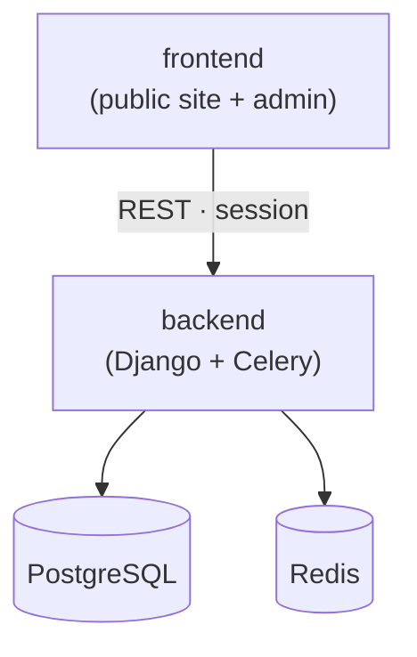

<p align="center">
  
</p>

---

# Request Manager

Workflow Support System for managing video shooting, filming and live-streaming requests of [Budavári Schönherz Stúdió](https://bsstudio.hu).

[](https://github.com/BSStudio/request-manager/actions/workflows/backend.yml)
[](https://github.com/BSStudio/request-manager/actions/workflows/frontend.yml)
[](LICENSE)

## Overview

The project is a monorepo made up of two deployable applications backed by PostgreSQL and Redis:

| Component              | Stack                                                                  | Description                                                                               |
| ---------------------- | ---------------------------------------------------------------------- | ----------------------------------------------------------------------------------------- |
| [`backend`](backend)   | Django, Django REST Framework, Celery, PostgreSQL                      | REST API, business logic, admin panel and async workers.                                  |
| [`frontend`](frontend) | React, TypeScript, Tailwind CSS, shadcn/ui, PrimeReact, TanStack Query | Public site where users submit and follow up requests, and the admin dashboard for staff. |

The frontend is a static build served by the backend in production (through WhiteNoise). Authentication is handled via OAuth2 (AuthSCH, BSS Login, Google, Microsoft) with a session cookie.



## Repository layout

```
.
├── backend/         Django REST API, Celery workers, admin panel
├── frontend/        Public site and admin dashboard (Vite, TypeScript)
├── .devcontainer/   VS Code dev container (Python + Node + uv)
├── docker-compose.dev.yaml   PostgreSQL + Redis for local development
└── docker-compose.yaml       Full production-like stack
```

## Getting started

The fastest way to get a complete toolchain is the **dev container**, which provisions Python, Node and uv and starts PostgreSQL + Redis automatically.

### Option A — Dev Container (recommended)

1. Install [Docker Desktop](https://www.docker.com/products/docker-desktop/) and the [VS Code Dev Containers](https://marketplace.visualstudio.com/items?itemName=ms-vscode-remote.remote-containers) extension.
2. Open the repository in VS Code and run **Dev Containers: Reopen in Container**.
3. Once the post-create step finishes, the `.env` files exist and the database is migrated and filled with test data. Run the apps, then log in as the test admin with `uv run python manage.py dev_session admin.aladar` in `backend/` (see [Test data](backend/README.md#test-data)).

> **Windows + WSL:** if the container fails to start with a `distro-services/<distro>.sock: no such file` error, enable Docker Desktop → Settings → Resources → **WSL Integration** for your distro (e.g. `Debian`).

### Option B — Manual setup

Start the infrastructure, then follow each component's README:

```bash
docker compose -f docker-compose.dev.yaml up -d --wait   # PostgreSQL + Redis
```

- [Backend setup](backend/README.md)
- [Frontend setup](frontend/README.md)

The backend setup ends with `seed_dev_data`, which fills the database with test data.

**Prerequisites for manual setup:** [uv](https://docs.astral.sh/uv/) and Node.js, plus Docker for PostgreSQL + Redis. uv installs the Python version pinned in `backend/.python-version`; the Node.js version is pinned in `frontend/.nvmrc`.

## Development

This repository uses [pre-commit](https://pre-commit.com/) for formatting and linting (Black, isort, flake8, Prettier, ESLint and more). Install the hooks at once from the repository root:

```bash
uv tool install pre-commit
pre-commit install
```

Run all checks manually with `pre-commit run --all-files`.

Node and Python versions are pinned in a single place each and kept up to date by Renovate:

- Node.js — `frontend/.nvmrc`
- Python — `backend/.python-version`

## Releases

Publishing a GitHub release with a `vX.Y.Z` tag builds the Docker image tagged `X.Y.Z`, `X.Y` and `latest`, and creates the Sentry release `request-manager@X.Y.Z` with its commits, which the backend and the frontend both report. Every other build is versioned `X.Y.Z.<commits since the tag>+<hash>`, or `X.Y.Z.<commits>+<branch>.<hash>` off `main`, so Sentry orders it after the release it builds on; only `vX.Y.Z` tags on the first-parent history count. The workflow needs the `SENTRY_AUTH_TOKEN` repository secret, a Sentry organization token, to create the release and upload the frontend's source maps.

## License

Distributed under the GNU General Public License v3.0. See [`LICENSE`](LICENSE).
